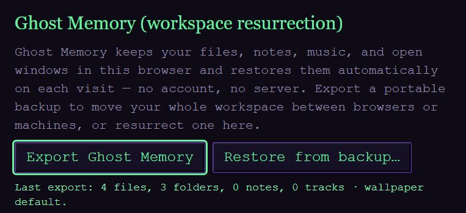
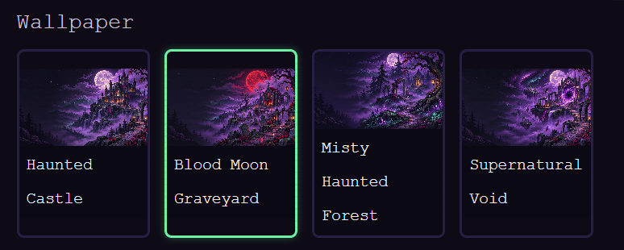
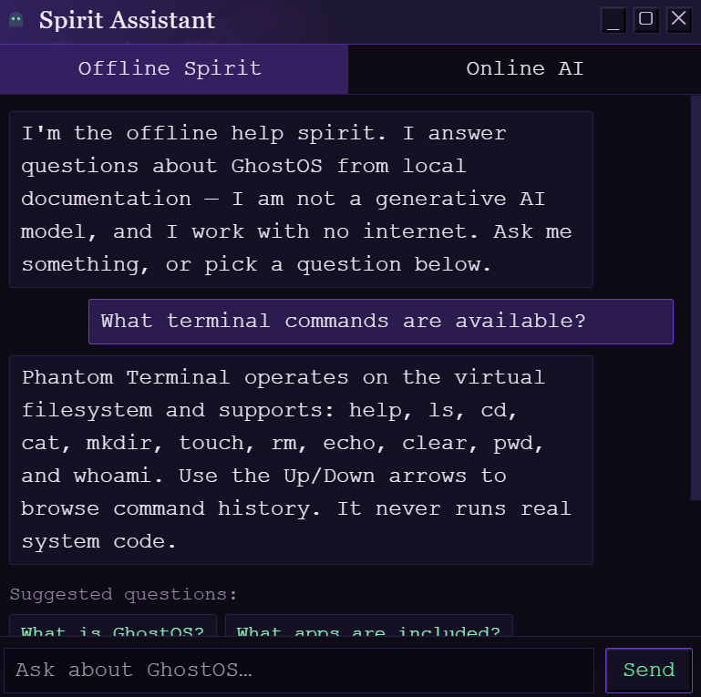
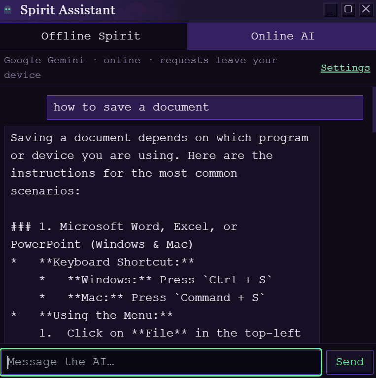
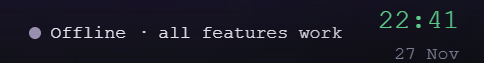

# GhostOS 👻

**Your desktop, your data, your machine — no cloud required.** GhostOS is a browser-based
retro-gothic desktop environment built for **digital independence and offline
productivity**: a window manager, desktop, start menu, taskbar, and a suite of built-in
apps that run **fully offline** in your browser, with no backend, no accounts, and no
external APIs for core features. Everything you create lives in your own browser storage.


### 🪦 Ghost Memory — the signature feature

GhostOS treats your entire workspace as something you **own and can resurrect anywhere**.
**Ghost Memory** persists your files, notes, music library, settings, and open-window
layout locally and restores them automatically on every visit. You can **export your whole
workspace to a single portable JSON backup** and **resurrect it** in any browser or on any
machine — with a backup summary, a pre-restore preview, an explicit replacement
confirmation, and safeguards that prevent a half-written restore from being reported as a
success. It is digital independence made concrete: your workspace is portable, inspectable,
and never locked to a server.


> **Kiroween 2026 — Resurrection category.** Built spec-first with Kiro (specs, steering,
> hooks, and property-based testing). See [`docs/KIRO.md`](docs/KIRO.md) for the full
> development write-up.

- **▶️ Live demo:** https://yxingggg.github.io/ghostos/
- **Repository:** https://github.com/yxingggg/ghostos

---

## Project status

GhostOS is **feature-complete and verified by CI**. The GitHub Actions
[CI workflow](.github/workflows/ci.yml) runs green on `main`:

| Check | Status |
|-------|--------|
| Install dependencies | ✅ |
| Type-check (`tsc`, strict) | ✅ |
| Lint (ESLint, `.ts`/`.tsx`) | ✅ |
| Test (Vitest) | ✅ **204 unit/integration tests, 25 files** (incl. WM & VFS property-based) |
| End-to-end (Playwright, Chromium) | ✅ **21 E2E tests** |
| Production build (Vite) | ✅ bundle + service worker emitted |

**Deployment:** the Deploy workflow runs green (quality gate, build, artifact upload, and
the `deploy-pages` publish job), and GitHub's deployment record for the `github-pages`
environment reports `state: success` at **https://yxingggg.github.io/ghostos/**. The
deployed artifact was inspected and all assets are correctly served under the `/ghostos/`
base path (JS, CSS, SVG icons, PWA manifest, service worker). The **live in-browser
behavior** (HTTP 200 render, console-error state, runtime persistence/offline) was **not**
verified from the authoring environment — it has no outbound access to `github.io` — so
confirm it in a browser. See [Limitations](#limitations-and-remaining-verification).

---

## Features

- **🪦 Ghost Memory (signature feature)** — your desktop, files, notes, music library,
  settings, and open-window layout are restored automatically each visit, and your whole
  workspace is **portable**: export it to a single JSON backup and resurrect it in any
  browser or machine. The restore flow shows a backup summary and a pre-restore preview,
  requires an explicit "replace my workspace" confirmation, reports partial/failed writes
  honestly (never a false success), and freezes further writes in the tab after a
  successful restore so a pending autosave cannot clobber the restored data before you
  reload. All offline, no server.

  

- **Premium haunted look** — an original GhostOS logo and ghost mascot ("Wisp"), distinctive
  illustrated app icons, and four detailed wallpapers (Haunted Castle, Blood Moon
  Graveyard, Misty Haunted Forest, Supernatural Void). Each ships as a ChatGPT-generated
  WebP that renders by default, backed by an **original hand-authored SVG scene fallback**
  (moon, stars, lit windows, cliffs, layered pines, atmospheric fog). All wallpapers are
  bundled locally, so the app stays offline. (See [Assets & provenance](#assets--provenance).)

  

- **First-launch welcome** — a branded intro that seeds sample files into your filesystem
  and offers quick actions (including "Restore a backup"); shown once.
- **Atmospheric boot sequence** — a retro BIOS-style summoning on load.
- **Window manager** — draggable, resizable windows with minimize, maximize/restore,
  close, focus/z-order management, and cascade placement.

  

- **Desktop shell** — original pixel-gothic icons, a start menu, and a taskbar with a
  live clock and per-window buttons.
- **Persistent virtual file system** — a single-rooted tree stored in IndexedDB.
- **Tomb Explorer** — a file manager: create/rename/delete/duplicate/download/navigate,
  a right-click context menu, Properties, and **opening files** (double-click or Enter)
  into the right app by type.
- **GraveNotes** — a persistent note editor (debounced autosave, ordered by recency) that
  also opens and edits text/Markdown files from the filesystem in place.
- **Spectral Viewer** — view images from the filesystem, import local files or drag-and-drop
  (they also land in Tomb Explorer), with zoom, rotate, fit-to-window, actual-size, and an
  original bundled sample image.
- **Phantom Terminal** — a simulated shell operating **only** on the virtual file system
  (`help`, `ls`, `cd`, `cat`, `mkdir`, `touch`, `rm`, `echo`, `clear`, `pwd`, `whoami`)
  with command history.
- **Calculator** — full keyboard + button input, divide-by-zero handled gracefully.
- **DeadWave** — a local audio player: import via button or drag-and-drop (or open audio
  from Tomb Explorer), playlist, play/pause/stop/prev/next/seek/volume/mute/repeat, a
  real-time Web Audio spectrum visualizer, and three **original** locally-synthesized demo
  tracks (Midnight Transmission · Spectral Frequencies · Echoes from 1998) playable with
  one click — no streaming, no bundled audio files, never autoplayed. DeadWave keeps its
  own persisted music library (separate from the Tomb Explorer filesystem); audio opened
  *from* Tomb Explorer is filesystem-backed, while audio imported directly into DeadWave
  lives in the player's library (see [Limitations](#limitations-and-remaining-verification)).
- **Settings** — toggle CRT effects, reduced motion, and sound; export/import your whole
  workspace as a JSON backup.
- **Spirit Assistant** — two clearly separated modes. The default **offline help mode** is
  rule-based: it answers questions about GhostOS from local documentation with clickable
  suggested questions, needs no API key or network, and explicitly tells you it is **not** a
  generative AI model. The **optional online AI mode** is opt-in and uses a provider you
  configure (OpenAI, Google Gemini, or a custom OpenAI-compatible endpoint) with a Test
  Connection button and graceful error handling. In online mode your requests leave your
  device; your API key stays in session memory (never saved or exported), is never sent over
  non-HTTPS, and only your messages are sent — never your files or notes.

  <table>
    <tr>
      <td width="50%" valign="top">
        
        <br /><sub><b>Offline help mode (default)</b> — rule-based answers from local docs; no network, not a generative model.</sub>
      </td>
      <td width="50%" valign="top">
        
        <br /><sub><b>Optional online AI (opt-in)</b> — your configured provider (here Google Gemini); requests leave your device, API key stays session-only.</sub>
      </td>
    </tr>
  </table>

- **Offline-first** — a service worker precaches the app shell so it runs without a
  network. All assets are bundled or generated locally. A taskbar indicator tells you your
  connectivity honestly — and reassures you that losing the network changes nothing for
  core features:

  

  <sub>Every core feature keeps working offline. The one exception is the <b>optional online AI</b> mode of Spirit Assistant, which needs a network connection; its default offline help mode does not.</sub>

- **Accessible & responsive** — keyboard-operable controls, ARIA roles/labels, visible
  focus, `prefers-reduced-motion` support, and a stacked layout on small screens.

## Tech stack

React 18 · TypeScript (strict) · Vite · Tailwind CSS · Zustand · IndexedDB (`idb`) ·
Web Audio API · Vitest + Testing Library · fast-check (property-based testing) ·
`vite-plugin-pwa` (offline service worker).

## Getting started

Requires Node.js 18+.

```bash
npm ci           # install from the committed package-lock.json (reproducible)
npm run dev      # start the Vite dev server
npm run build    # type-check + production build into dist/
npm run preview  # preview the production build
```

> `package-lock.json` is committed, so `npm ci` gives a reproducible install and is what CI
> uses. (`npm install` also works if you need to update dependencies.)

### Quality scripts

```bash
npm run typecheck   # tsc --noEmit (strict)
npm run lint        # eslint
npm test            # vitest run (unit + property + integration)
npm run test:watch  # vitest in watch mode
npm run test:coverage
```

## Architecture

GhostOS is layered with a strict one-directional dependency rule: **UI → State → Core**.

```
src/
  core/      pure, framework-free logic (the main test target)
    wm/        window-manager reducer + types
    vfs/       virtual filesystem operations + types
    calc/      calculator state machine
    terminal/  command interpreter over the VFS
  state/     Zustand stores + IndexedDB persistence (side effects live here)
  apps/      built-in apps, each registered via the app registry
  ui/        desktop shell: WindowFrame, Desktop, Taskbar, StartMenu, CRT overlay
  assets/    original SVG icon set
  sound/     synthesized sound effects (no audio files)
  styles/    Tailwind entry + CSS/SVG wallpaper + CRT effects
```

- **Core** modules are pure: no React, DOM, or IndexedDB. They return new state or a
  `{ ok } | { ok: false; error }` result. This is what the unit and property-based tests
  exercise directly.
- **Apps are decoupled** from the shell through an **app registry**
  (`src/apps/registry.ts`). The window manager, desktop, taskbar, and start menu iterate
  the registry — adding a new app means registering an `AppDefinition`, with no changes to
  the WM core.

The full requirements, design, and task breakdown live in
[`.kiro/specs/ghostos/`](.kiro/specs/ghostos/).

## Built with Kiro

GhostOS was developed spec-first with Kiro, and the artifacts are committed in
[`.kiro/`](.kiro/) so the workflow is inspectable:

- **Specs** ([`.kiro/specs/ghostos/`](.kiro/specs/ghostos/)) — `requirements.md`,
  `design.md`, and `tasks.md` were written before the implementation. The window-manager
  and VFS contracts (including the exact invariants the property tests assert) were defined
  in the spec first, then implemented against it.
- **Steering** ([`.kiro/steering/`](.kiro/steering/)) — three always-on rule files encode
  the engineering standards every change had to respect: the **architecture** layering
  (UI → State → Core) and app-registry rule, **TypeScript** strictness (no `any`,
  discriminated unions, annotated return types), and the **testing** policy (what to
  unit-test, which invariants to property-test, and the quality gates).
- **Hooks** ([`.kiro/hooks/`](.kiro/hooks/)) — a core-test reminder hook (scoped to
  `src/core/**`, excluding test files) and an on-demand quality-review hook that checks
  layering, strictness, the fallible-result convention, and test coverage.
- **Property-based testing** — invariants of the window manager and virtual filesystem are
  asserted with `fast-check` across random action/operation sequences (see below).

For the full narrative — how each spec, steering rule, hook, and property test shaped the
code — see **[`docs/KIRO.md`](docs/KIRO.md)**.

## Testing

- **Unit** tests cover the calculator engine, terminal interpreter, every VFS operation,
  and every window-manager action (including edge cases: divide-by-zero, unknown command,
  closing the focused window, maximize/restore).
- **Property-based** tests (fast-check) assert invariants:
  - **Window manager** — focus uniqueness, order/z integrity, bounds clamping, and
    double-maximize returning the original bounds, across random action sequences.
  - **Virtual filesystem** — single-parent/acyclic tree, delete-subtree, cycle-safe moves,
    and no sibling name collisions, across random operation sequences.
- **Integration** tests (Testing Library + `fake-indexeddb`) cover store behavior,
  persistence round-trips, and the desktop shell (launching/closing windows, start menu).

## Deployment

The production build is a static bundle in `dist/`, deployable to any static host.

- **GitHub Pages** — the included [`deploy.yml`](.github/workflows/deploy.yml) workflow
  builds with `GHOSTOS_BASE=/ghostos/` and publishes to **https://yxingggg.github.io/ghostos/**.
  Set `GHOSTOS_BASE` to match your repository's sub-path (or `/` for a root deployment on
  Netlify/Vercel/etc.).

See [`docs/DEPLOYMENT.md`](docs/DEPLOYMENT.md) for the full pipeline, verification status,
and a manual in-browser confirmation checklist.

## Privacy & offline

GhostOS has no backend and no telemetry. Your notes, files, and audio stay in your
browser's IndexedDB. The only code that can touch the network is the optional Spirit
Assistant, and only after you explicitly enable it and provide your own endpoint.

## Assets & provenance

GhostOS deliberately avoids any proprietary branding, logos, startup sounds, or
third-party icon packs. Provenance of what ships:

- **Icons, logo, and mascot** — original, hand-authored SVG by this project.
- **Sound effects and the three DeadWave demo tracks** — original audio synthesized at
  runtime in code (no sampled or bundled audio files).
- **Wallpapers** — each of the four scenes ships as a **WebP image generated with ChatGPT
  image generation**, which renders by default. No third-party copyrighted artwork was
  traced or copied; GhostOS makes no licensing claim about the AI-generated output beyond
  the terms of the tool that produced it. Behind each raster image is an **original
  hand-authored SVG scene** (`src/assets/wallpapers.tsx`) that serves as the offline
  fallback and default when no raster file is present. See
  [`src/assets/wallpapers/README.md`](src/assets/wallpapers/README.md) for the full
  provenance note.

**External audio used only for testing (not shipped).** During development, DeadWave's
local-file playback and import were manually tested with an external track, *"Flow
Electric"* by **1000 Handz**. This track is **not** included in the repository, **not**
tracked in git, and **not** bundled or precached in the build — the PWA precache lists no
audio file types, and the only audio GhostOS distributes is the runtime-synthesized demo
tracks and sound effects above. All rights to *"Flow Electric"* belong to its creator;
GhostOS claims **no ownership and no licensing rights** to it and merely credits it as a
test input. To reproduce the test, supply your own audio file via DeadWave's Import button.

## Limitations and remaining verification

Honest status of what has and hasn't been confirmed:

- **Verified by CI, not in the authoring sandbox.** The authoring environment had no npm
  registry or general internet access, so the suite/build were executed by GitHub Actions.
  CI is green on `main` (install via `npm ci`, type-check, lint, **204 unit/integration
  tests + 21 Playwright E2E tests**, production build), and the Pages deployment job
  succeeded (deployment record `state: success`).
- **Live browser behavior is NOT yet verified.** The authoring environment cannot reach
  `github.io`, so the live site's HTTP response, in-browser rendering, console errors, and
  runtime persistence/offline behavior were not tested by execution. The deployed *artifact*
  was inspected and is correct (all assets base-pathed to `/ghostos/`, valid PWA manifest
  and service worker), but please confirm the running app at
  https://yxingggg.github.io/ghostos/ in a browser.
- **`package-lock.json` is committed** (generated in CI via the
  [generate-lockfile workflow](.github/workflows/generate-lockfile.yml)), so installs are
  reproducible and CI uses `npm ci`.
- **Web fonts are not bundled.** To stay fully offline, GhostOS uses system-font fallbacks
  for the pixel/gothic look rather than loading fonts from a CDN. For the authentic bitmap
  typeface, drop self-hosted `.woff2` files into `src/assets/fonts/` and uncomment the
  `@font-face` blocks in `src/styles/fonts.css`.
- **AI assistant requires your own endpoint.** It is disabled by default and never
  contacts the network unless you enable it and supply an endpoint; it refuses to send an
  API key over a non-HTTPS endpoint.
- **Audio visualization** needs the Web Audio API; where it is unavailable, audio still
  plays and the visualizer renders a flat baseline instead of failing.
- **Ghost Memory restore safety.** Restore replaces your current workspace and is
  best-effort, not a single atomic transaction across storage stores: a write that fails
  partway can leave a partial replacement, which GhostOS reports explicitly rather than
  claiming success. After a successful restore the tab freezes further writes until you
  reload, so a pending autosave cannot overwrite the restored data; this guard is
  per-tab, so you should close other GhostOS tabs before restoring (the confirm dialog
  says so). Export your current workspace before restoring if you want to keep it.
- **DeadWave keeps a separate music library.** Audio you import directly into DeadWave is
  stored in the player's own persisted library (in IndexedDB) and does not appear as a file
  in Tomb Explorer; audio opened *from* Tomb Explorer is filesystem-backed. This is
  intentional to avoid storing the same audio twice.

See [`.kiro/specs/ghostos/tasks.md`](.kiro/specs/ghostos/tasks.md) for per-task status
(`[~]` = implemented but not yet verified by execution; `[x]` = verified).

## License

Licensed under the [MIT License](LICENSE) — Copyright (c) 2026 yxingggg.
